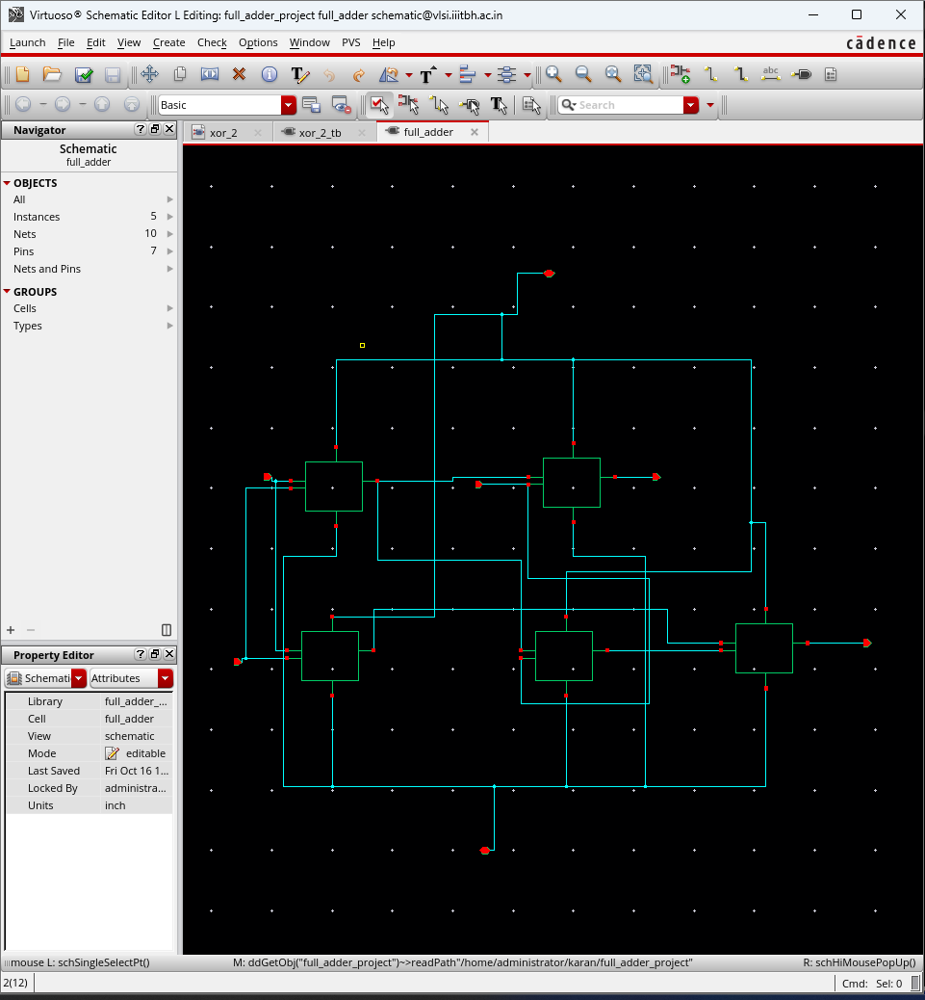
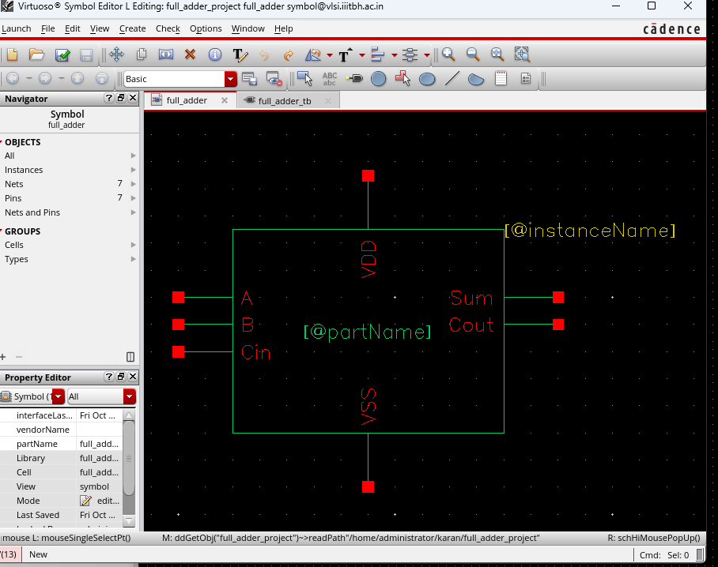
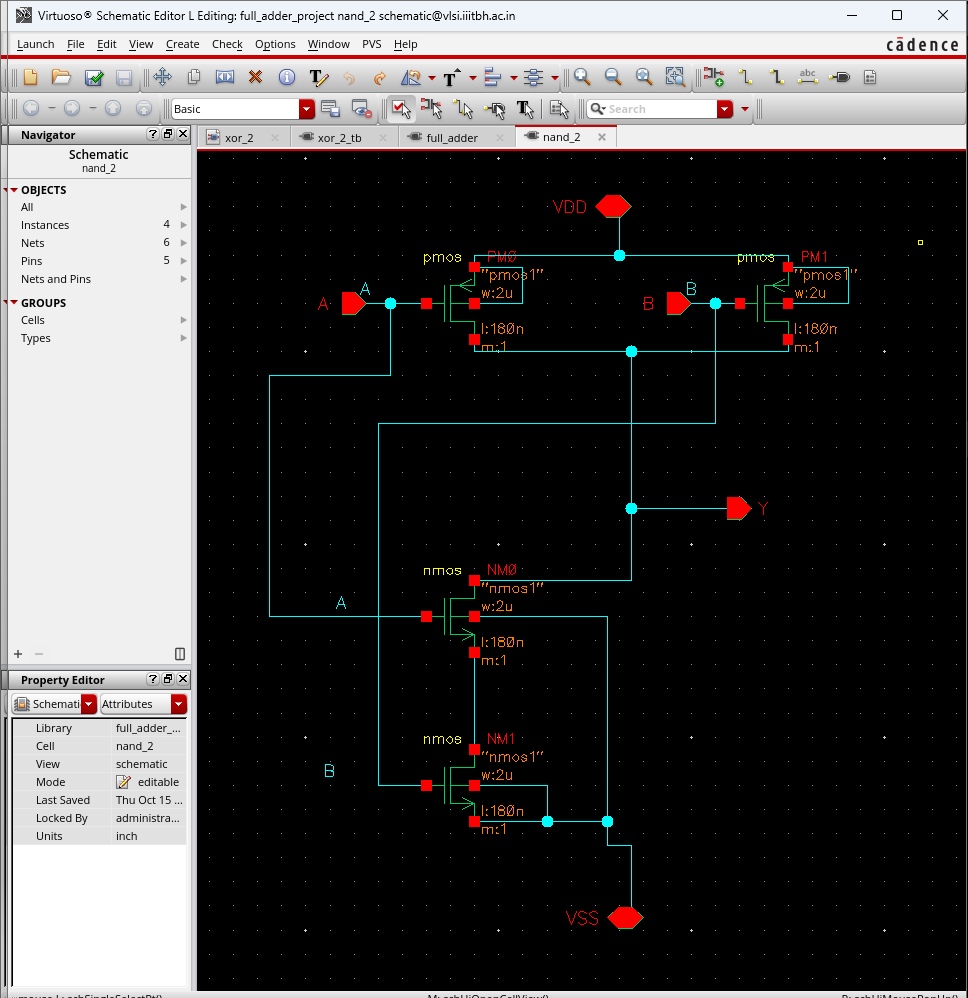
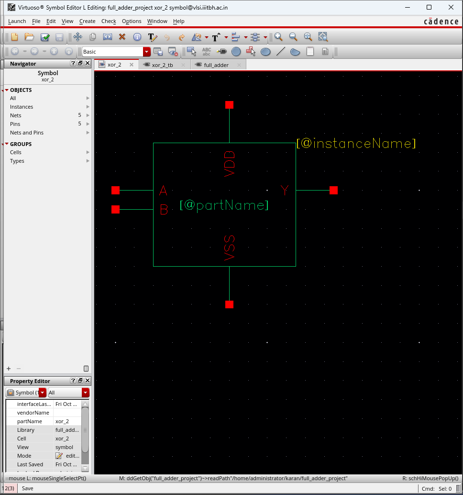
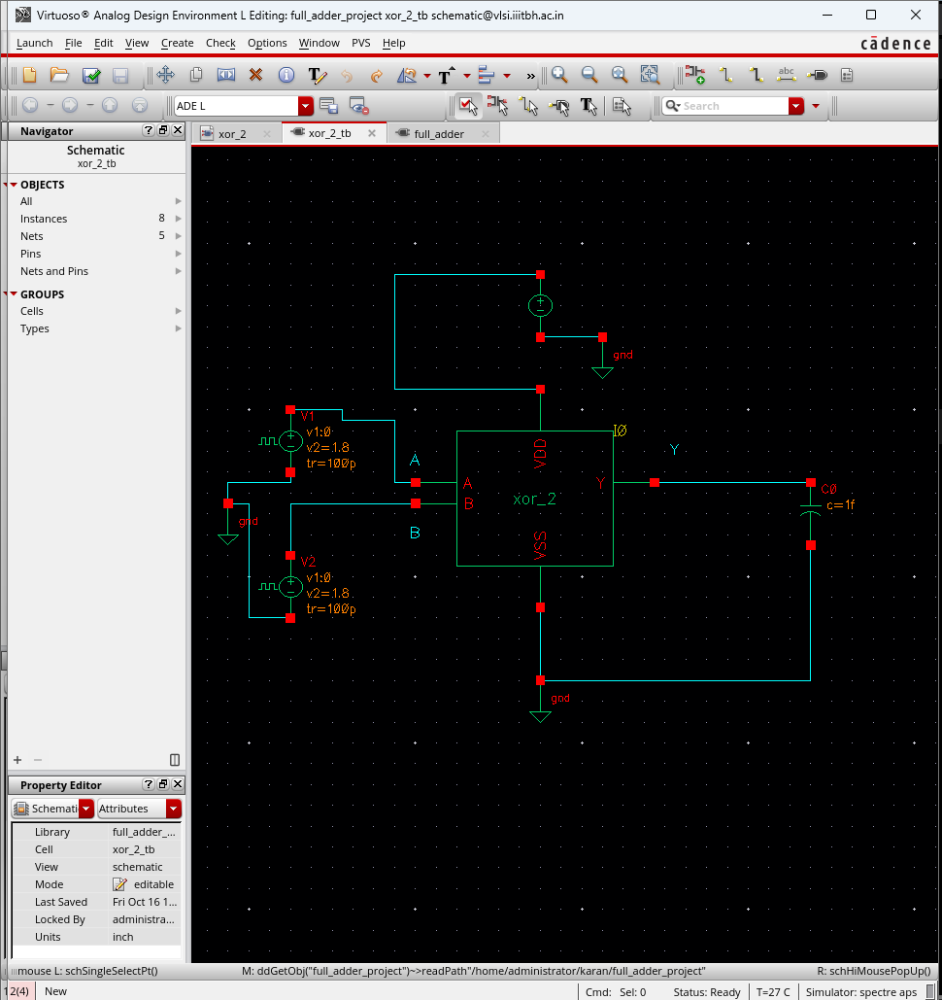
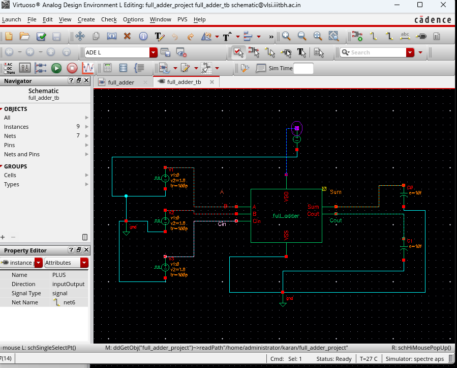
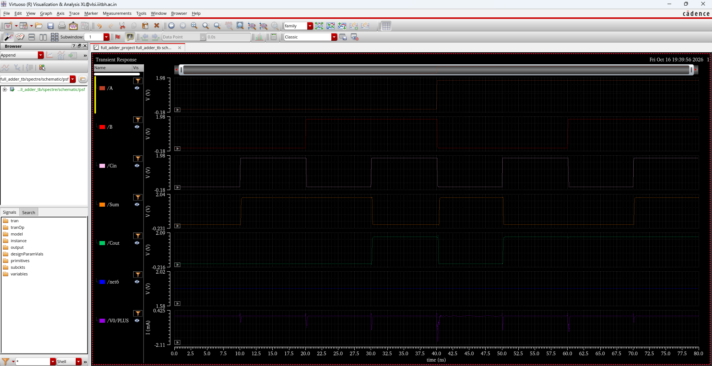
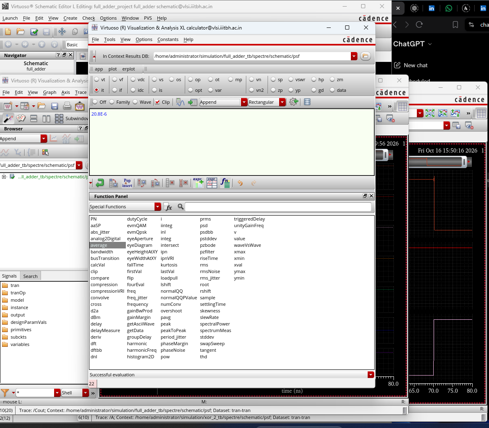
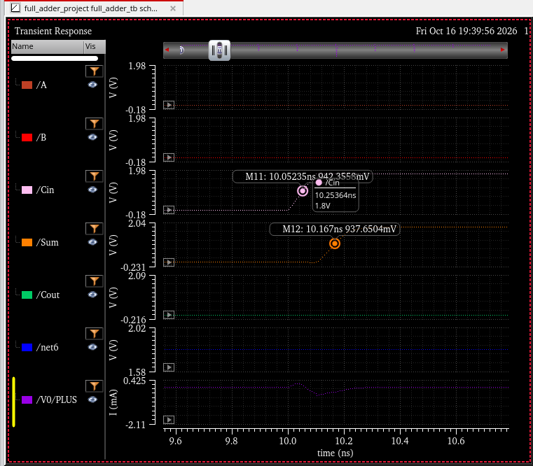
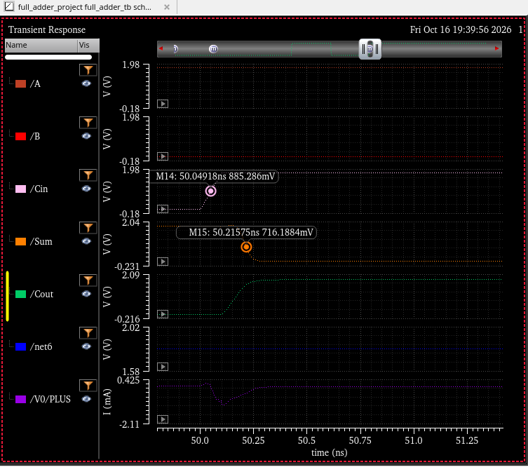

# CMOS 1-Bit Full Adder — Cadence Virtuoso IC618

A transistor-level and hierarchical static CMOS 1-bit full adder design implemented and simulated in **Cadence Virtuoso IC618** using the **Spectre** circuit simulator and Cadence **gpdk180** (Generic 180 nm Process Design Kit).

---

## 1. Project Overview

- **Design:** CMOS 1-Bit Full Adder (`full_adder`)
- **EDA Environment:** Cadence Virtuoso IC618 (tested version; OpenAccess 22.60)
- **Simulator:** Spectre Circuit Simulator
- **Technology Node:** Generic 180 nm CMOS Process (`gpdk180`)
- **Nominal Supply ($V_{DD}$):** 1.8 V
- **Verification Scope:** Schematic-level transient simulation across all 8 input states.
- **Scope Limitation:** **Schematic simulation only**. No physical layout, DRC (Design Rule Check), or LVS (Layout Versus Schematic) claims are made.

---

## 2. Design Hierarchy & Architecture

The library is organized modularly using hierarchical cellviews:

```
full_adder (Top-Level Cell)
├── xor_2 (2-input XOR subcell)
│   └── nand_2 (2-input NAND subcell)
│       ├── gpdk180 PMOS (Pull-up Network)
│       └── gpdk180 NMOS (Pull-down Network)
└── nand_2 (2-input NAND subcell)
    ├── gpdk180 PMOS (Pull-up Network)
    └── gpdk180 NMOS (Pull-down Network)
```

### Cells and Views Description

| Cell Name | Cell Type | Available Views | Supported / Active View | Description |
| :--- | :--- | :--- | :--- | :--- |
| **`full_adder`** | Top-Level Logic | `schematic`, `symbol` | `symbol` | 1-bit full adder implementing $\text{Sum} = A \oplus B \oplus C_{in}$ and $C_{out} = A\cdot B + C_{in}\cdot(A \oplus B)$ |
| **`full_adder_tb`** | Testbench | `schematic` | `schematic` | Testbench with 1.8 V DC supply, 3 staggered pulse sources, and output capacitive loads |
| **`xor_2`** | Subcell Gate | `schematic`, `symbol` | `symbol` | 2-input XOR gate constructed from 2-input NAND subcells (`nand_2`) |
| **`xor_2_tb`** | Testbench | `schematic` | `schematic` | Functional testbench for verifying `xor_2` |
| **`nand_2`** | Base Primitive | `schematic`, `symbol`, `symbol_1` | **`symbol`** | Transistor-level 2-input static CMOS NAND gate built with gpdk180 NMOS and PMOS transistors.<br><br>**Symbol View Notes:**<br>• **`symbol`**: The actively supported, official schematic symbol.<br>• **`symbol_1`**: An **obsolete view**, preserved for historical archive and backward compatibility. **Do not use for new instantiations, and do not delete.** |
| **`nand_2_tb`** | Testbench | `schematic` | `schematic` | Functional testbench for verifying `nand_2` |

### 2.1 Design & Symbol Schematics

#### Full Adder Top-Level
  
*Figure 1: Full adder schematic (`full_adder`) implemented with 2 `xor_2` gates and 3 `nand_2` gates.*

  
*Figure 2: Full adder schematic symbol (`full_adder`) showing input ports ($A, B, C_{in}$), outputs ($\text{Sum}, C_{out}$), and supply terminals ($V_{DD}, V_{SS}$).*

#### Subcells & Primitives
  
*Figure 3: Transistor-level schematic of the 2-input CMOS NAND gate (`nand_2`) in gpdk180 showing parallel PMOS pull-up and series NMOS pull-down transistors ($W = 2\,\mu\text{m}, L = 180\text{ nm}$).*

  
*Figure 4: Schematic symbol for the 2-input XOR gate (`xor_2`).*

  
*Figure 5: Simulation testbench schematic for the `xor_2` gate (`xor_2_tb`).*

---

## 3. Library & Cell Inventory

All schematic views, symbol views, and OpenAccess metadata (`cdsinfo.tag`, `.oalib`, `data.dm`, `master.tag`) have been fully preserved.

| Cell Name | Views Present | Saved ADE States | Metadata Status |
| :--- | :--- | :--- | :--- |
| **`full_adder`** | `schematic`, `symbol` | None (currently absent) | OpenAccess database intact; `data.dm` & `master.tag` preserved |
| **`full_adder_tb`** | `schematic` | None (currently absent) | OpenAccess database intact; `data.dm` & `master.tag` preserved |
| **`nand_2`** | `schematic`, `symbol` (supported), `symbol_1` (obsolete) | None (currently absent) | OpenAccess database intact; `data.dm` & `master.tag` preserved |
| **`nand_2_tb`** | `schematic` | None (currently absent) | OpenAccess database intact; `data.dm` & `master.tag` preserved |
| **`xor_2`** | `schematic`, `symbol` | None (currently absent) | OpenAccess database intact; `data.dm` & `master.tag` preserved |
| **`xor_2_tb`** | `schematic` | None (currently absent) | OpenAccess database intact; `data.dm` & `master.tag` preserved |

> **Status of Saved ADE States:**  
> Saved ADE states (such as ADE L `spectre_state*`, ADE XL `adexl`, or Maestro views) are **currently absent** from this library. To run simulations, follow the manual simulation setup instructions in Section 4.3.

---

## 4. Testbench Stimulus & Manual Simulation Setup

### 4.1 Testbench Input Pulse Settings (`full_adder_tb`)
The testbench generates all $2^3 = 8$ binary input combinations in an 80 ns transient simulation by applying synchronized, staggered pulses from `analogLib/vpulse` sources:

- **Common Parameters for All Inputs ($A$, $B$, $C_{in}$):**
  - Voltage 1 ($V_1$): `0 V`
  - Voltage 2 ($V_2$): `1.8 V`
  - Rise Time ($t_r$): `100 ps` (`100p`)
  - Fall Time ($t_f$): `100 ps` (`100p`)

- **Signal-Specific Timing Parameters:**
  | Signal | Delay Time (`td`) | Pulse Width (`pw`) | Period (`per`) | Function |
  | :---: | :---: | :---: | :---: | :--- |
  | **$A$** | `40n` (40 ns) | `40n` (40 ns) | `80n` (80 ns) | MSB input |
  | **$B$** | `20n` (20 ns) | `20n` (20 ns) | `40n` (40 ns) | Intermediate input |
  | **$C_{in}$** | `10n` (10 ns) | `10n` (10 ns) | `20n` (20 ns) | LSB / carry-in input |

### 4.2 Output Load Capacitance
- In `full_adder_tb/schematic`, the output load capacitors $C_0$ and $C_1$ (connected to `Sum` and `Cout`) are each set to **10 fF** (`c = 10f`).
- **Notice on Output Capacitor Verification:**  
  *Output capacitor values must always be checked and verified directly against the actual schematic before documenting or modifying them, ensuring consistent capacitive loading and delay measurements across environments.*

  
*Figure 6: Full adder testbench schematic (`full_adder_tb`) configured with 1.8 V DC power supply, three pulsed stimulus sources for inputs $A, B, C_{in}$, and 10 fF load capacitors.*

### 4.3 Manual ADE Simulation Setup Instructions
Because saved ADE states are currently absent, configure the simulation manually in Cadence Virtuoso as follows:

1. **Open Testbench:** Open `full_adder_project` $\to$ `full_adder_tb` $\to$ `schematic`.
2. **Launch ADE:** In the schematic window menu, select **Launch** $\to$ **ADE L** (or **ADE Explorer**).
3. **Select Simulator:**  
   Choose **Setup** $\to$ **Simulator/Directory/Host...** and select **`spectre`**.
4. **Configure Model Libraries:**  
   - Choose **Setup** $\to$ **Model Libraries...**.
   - Add the path to your installed gpdk180 model file: `<path_to_gpdk180_model_file>`.
   - Set the Section to **`NN`** (nominal NMOS / nominal PMOS corner).
5. **Verify DC Supply:**  
   Confirm the DC power supply $V_{DD}$ source (`vdc`) is set to **1.8 V**.
6. **Configure Transient Analysis:**  
   - Choose **Analyses** $\to$ **Choose...**.
   - Select **`tran`**.
   - Set **Stop Time** to **`80n`** (80 ns).
7. **Select Outputs to Plot:**  
   - Inputs: `A`, `B`, `Cin`
   - Outputs: `Sum`, `Cout`
8. **Add Average Power Measurement Expression:**  
   In ADE Outputs (or the Spectre Calculator), define the average power expression:
   ```text
   -1.8 * average(IT("/V0/PLUS"))
   ```
9. **Run Simulation:**  
   Click **Simulation** $\to$ **Netlist and Run** (green play icon).

---

## 5. Simulation Results & Performance Summary

Simulations were performed using the Spectre circuit simulator under nominal conditions ($T = 27\,^\circ\text{C}$, $V_{DD} = 1.8\text{ V}$, section `NN`).

### 5.1 Functional Verification (Truth Table)
All **8 input combinations** ($2^3$) were simulated and functionally verified over the 0–80 ns transient window:

| State | Time Interval | $A$ | $B$ | $C_{in}$ | Expected $\text{Sum}$ | Expected $C_{out}$ | Verification Status |
| :---: | :---: | :---: | :---: | :---: | :---: | :---: | :---: |
| 0 | 0 – 10 ns | 0 | 0 | 0 | 0 | 0 | **Verified** |
| 1 | 10 – 20 ns | 0 | 0 | 1 | 1 | 0 | **Verified** |
| 2 | 20 – 30 ns | 0 | 1 | 0 | 1 | 0 | **Verified** |
| 3 | 30 – 40 ns | 0 | 1 | 1 | 0 | 1 | **Verified** |
| 4 | 40 – 50 ns | 1 | 0 | 0 | 1 | 0 | **Verified** |
| 5 | 50 – 60 ns | 1 | 0 | 1 | 0 | 1 | **Verified** |
| 6 | 60 – 70 ns | 1 | 1 | 0 | 0 | 1 | **Verified** |
| 7 | 70 – 80 ns | 1 | 1 | 1 | 1 | 1 | **Verified** |

  
*Figure 7: Spectre transient response (0–80 ns) confirming all 8 truth-table combinations for inputs $A, B, C_{in}$ and outputs $\text{Sum}$ and $C_{out}$.*

### 5.2 Power Consumption
- **Average $V_{DD}$ Power:** **20.8 µW**
- **Evaluation Window:** 0 to 80 ns continuous transient operation (cycling through all 8 binary states).
- **Power Measurement Expression:** Calculated from the DC supply source (`V0`) current via the ADE / Spectre calculator expression:
  ```text
  -1.8 * average(IT("/V0/PLUS"))
  ```

  
*Figure 8: Virtuoso calculator evaluation showing an average supply power of **20.8 µW** (`20.8E-6` W) across the 0–80 ns simulation window.*

### 5.3 Propagation Delay ($C_{in} \to \text{Sum}$)
- **Approximate Rising Delay ($t_{pLH}$):** **~115 ps**
- **Approximate Falling Delay ($t_{pHL}$):** **~162 ps**

> **Important Measurement Methodology Note:**  
> Delay markers were placed manually near 0.9 V, not exactly at the 50% voltage threshold, on the input $C_{in}$ and output $\text{Sum}$ waveforms under different $A/B$ excitation conditions. Delays are approximate (~115 ps rising, ~162 ps falling) and do not represent exhaustive worst-case characterization.

  
*Figure 9: Approximate $C_{in}$-to-$\text{Sum}$ rising delay measurement (~115 ps) with markers placed near 0.9 V (`M11` on $C_{in}$ at 10.052 ns / 942 mV; `M12` on $\text{Sum}$ at 10.167 ns / 938 mV).*

  
*Figure 10: Approximate $C_{in}$-to-$\text{Sum}$ falling delay measurement (~162 ps) with markers placed near 0.9 V (`M14` on $C_{in}$ at 50.049 ns / 885 mV; `M15` on $\text{Sum}$ at 50.216 ns / 716 mV).*

---

## 6. Cadence Virtuoso Integration & Lock Handling

### 6.1 Library Definition (`cds.lib`)
Add the library path to your working directory's `cds.lib` file:

```text
DEFINE full_adder_project <path_to_full_adder_project>
```

Example relative path entry:
```text
DEFINE full_adder_project ./full_adder_project
```

### 6.2 Prerequisites & Dependencies
1. **Cadence Virtuoso:** IC618 (specifically tested on Cadence Virtuoso IC6.1.8-64b; compatibility with other Virtuoso versions has not been verified).
2. **Technology PDK:** Cadence `gpdk180` (Generic 180 nm PDK). The library references `techLibName gpdk180` for transistor models (`nmos`, `pmos`).
3. **Reference Library:** Standard Cadence `analogLib` for voltage supplies (`vdc`), signal sources (`vpulse`), capacitors (`cap`), and ground symbols (`gnd`).
4. **Third-Party PDK Protection:** Proprietary PDK directories and foundry libraries are excluded by `.gitignore`. User-authored design files with extensions such as `*.scs`, `*.va`, or `*.lib` are not globally excluded.

### 6.3 Handling Cadence Lock Files
- Downloaded Cadence lock files (`*.cdslck*`) remain in the local workspace so the downloaded directory is preserved without modification.
- All lock files are strictly ignored by Git via `.gitignore`, ensuring they are never tracked or committed to GitHub.
- Cloned copies from GitHub will be clean of lock files. Live Virtuoso sessions create and manage their own local locks normally.

---

## 7. Repository Structure

```
full_adder_project/
├── .gitattributes                     # Ensures binary file integrity and LF line endings
├── .gitignore                          # Excludes Cadence locks, logs, sim outputs, and PDK directories
├── .oalib                              # OpenAccess library configuration XML
├── cdsinfo.tag                         # Cadence library identification and namespace definition
├── data.dm                             # Library DM metadata (techLib: gpdk180, CDF)
├── README.md                           # Project documentation and simulation summary
│
├── screenshots/                        # Directory for schematics and simulation waveforms
│   ├── .gitkeep
│   └── README.md
│
├── full_adder/                         # Top-level 1-bit full adder
│   ├── data.dm
│   ├── schematic/
│   │   ├── data.dm                     # View dependency mapping
│   │   ├── master.tag                  # OA master reference (sch.oa)
│   │   ├── sch.oa                      # OpenAccess schematic binary database
│   │   └── thumbnail_128x128.png       # Virtuoso preview thumbnail
│   └── symbol/
│       ├── master.tag                  # OA master reference (symbol.oa)
│       ├── symbol.oa                   # OpenAccess symbol binary database
│       └── thumbnail_128x128.png       # Virtuoso preview thumbnail
│
├── full_adder_tb/                      # Testbench for full adder
│   └── schematic/
│       ├── data.dm
│       ├── master.tag
│       ├── sch.oa
│       └── thumbnail_128x128.png
│
├── nand_2/                             # 2-input CMOS NAND gate primitive
│   ├── data.dm
│   ├── schematic/
│   │   ├── data.dm
│   │   ├── master.tag
│   │   ├── sch.oa
│   │   └── thumbnail_128x128.png
│   ├── symbol/                         # Supported active NAND symbol
│   │   ├── master.tag
│   │   ├── symbol.oa
│   │   └── thumbnail_128x128.png
│   └── symbol_1/                       # Obsolete view (preserved; do not delete)
│       ├── master.tag
│       ├── symbol.oa
│       └── thumbnail_128x128.png
│
├── nand_2_tb/                          # Testbench for 2-input NAND gate
│   └── schematic/
│       ├── data.dm
│       ├── master.tag
│       ├── sch.oa
│       └── thumbnail_128x128.png
│
├── xor_2/                              # 2-input XOR gate (built from NAND gates)
│   ├── data.dm
│   ├── schematic/
│   │   ├── data.dm
│   │   ├── master.tag
│   │   ├── sch.oa
│   │   └── thumbnail_128x128.png
│   └── symbol/
│       ├── master.tag
│       ├── symbol.oa
│       └── thumbnail_128x128.png
│
└── xor_2_tb/                           # Testbench for 2-input XOR gate
    └── schematic/
        ├── data.dm
        ├── master.tag
        ├── sch.oa
        └── thumbnail_128x128.png
```

---

## 8. License & Disclaimer

- **Design Purpose:** Academic / educational design and demonstration of CMOS arithmetic logic in Cadence Virtuoso.
- **PDK Notice:** Requires Cadence `gpdk180` and `analogLib`. Neither gpdk180 nor any proprietary model files are distributed with this repository.
